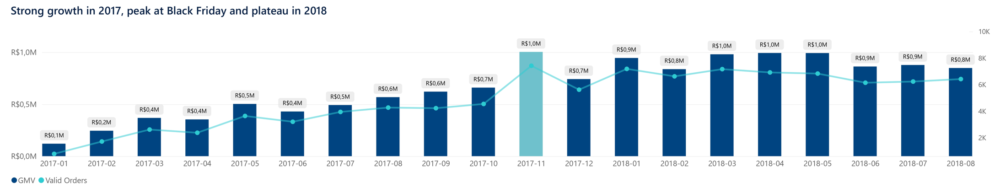
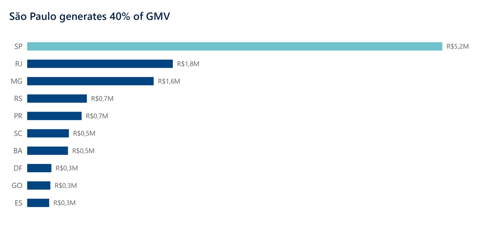
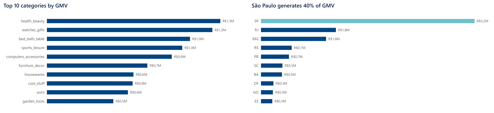
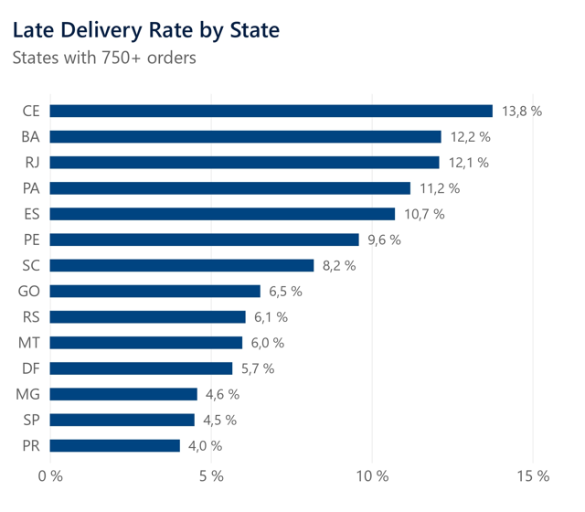
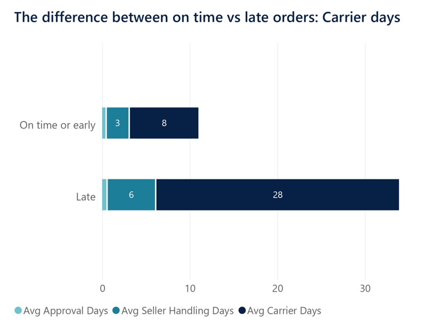
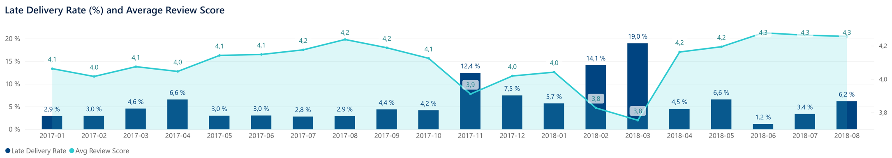
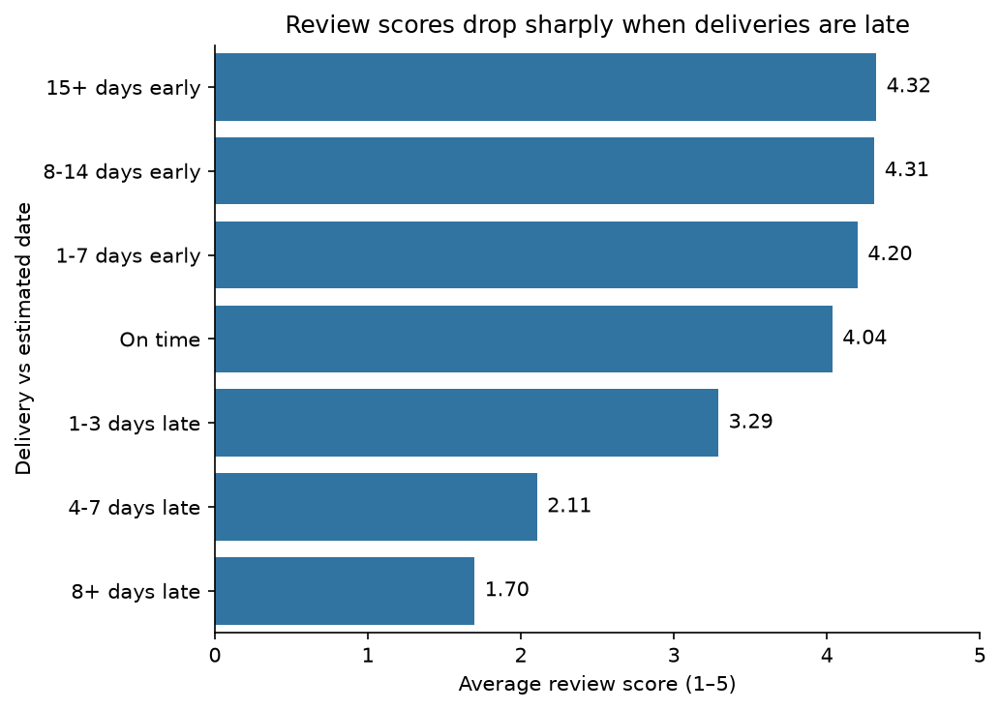
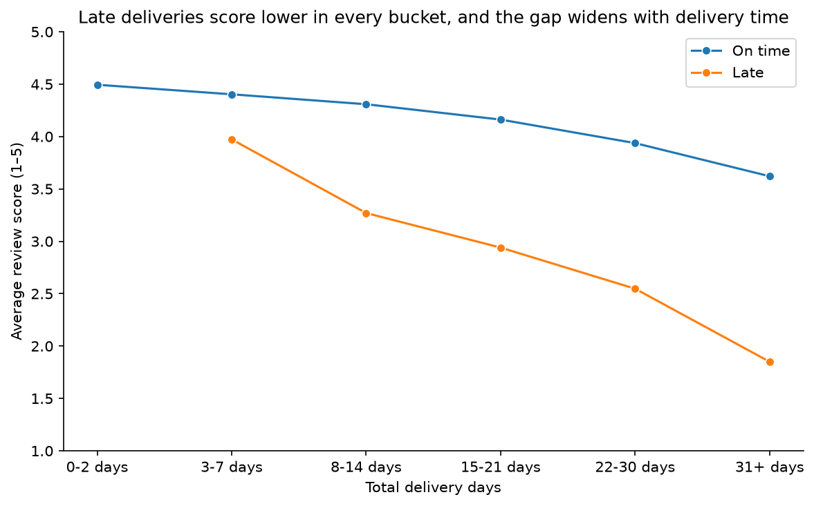
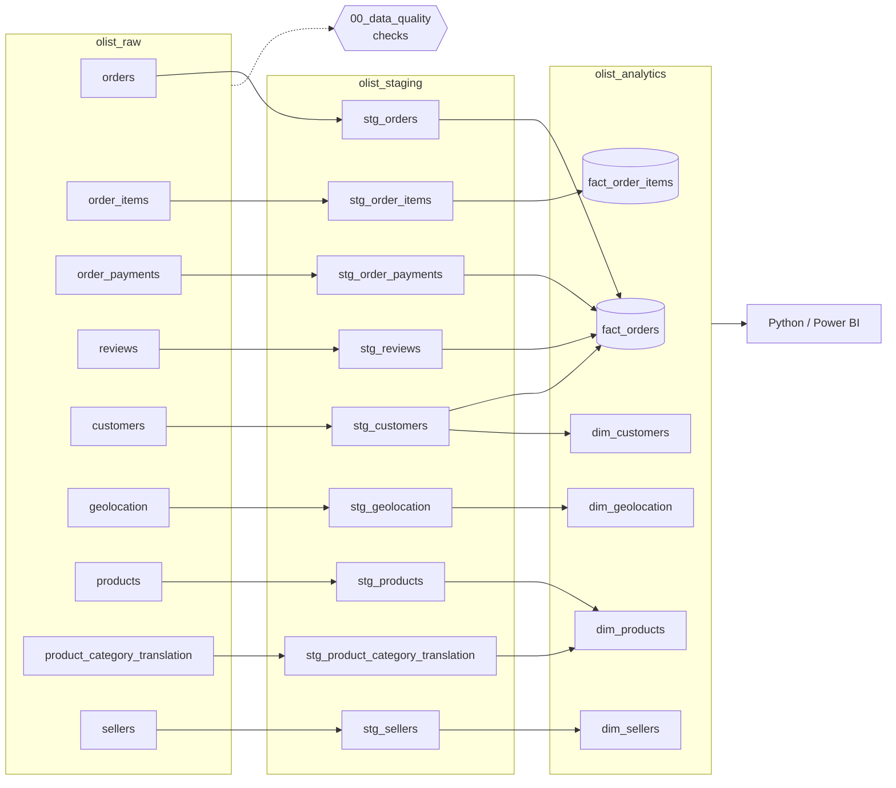
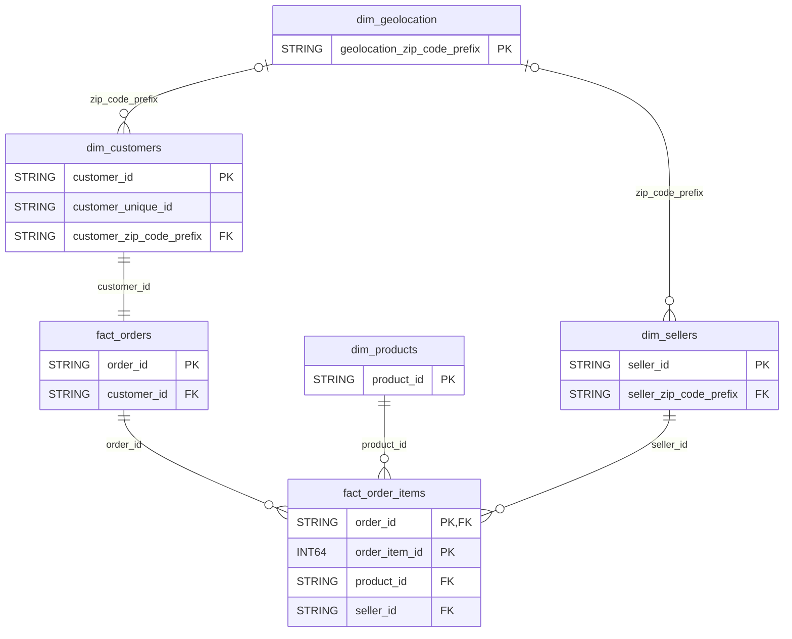

# Olist E-commerce Analytics

End-to-end analytics project on Olist's Brazilian marketplace data: **BigQuery (SQL) → Python → Power BI**.

## Key findings

**1. Olist grew fast through 2017 and plateaued in 2018.**
Monthly GMV rose from R\$0.1M in January-2017 to ~R\$1.0M in Nov-2017. Since then it has stabilised at R\$0.85–1.0M per month (~6–7K orders), indicating that growth has stalled.



**2. Revenue is concentrated in São Paulo.**
SP generates ~40% of GMV (R\$5.2M of R\$13M). RJ and MG follow with ~14% and ~12%. Any operational problem in the Southeast directly hits the bulk of revenue.



**3. Health & beauty is the leading category.**
It is the top category by GMV, with R\$1.3M overall. Between Jan–Aug 2017 and Jan–Aug 2018, its GMV went from R\$0.2M to R\$0.8M.



**4. Customers rarely come back.**
Only 3.0% of customers placed more than one order. The dataset covers less than two years, so this partly reflects a short observation window, but repeat purchases are clearly not a growth driver today.

**5. Delivery estimates are very conservative, yet 6.8% of orders still arrive late.**
93% of orders arrive on or before the estimated date, and over a third arrive 15+ days early. Late deliveries are concentrated geographically: RJ, the second-largest state by GMV, has a 12.1% late rate, almost 3x SP (4.5%). CE (13.8%) and BA (12.2%) are the worst large states.



**6. Delays originate mainly in the carrier stage.**
Late orders spend 27.9 days with the carrier vs 8.0 for on-time or early orders. Seller handling also doubles, from 2.6 to 5.6 days.



**7. Late-delivery spikes are not only demand-driven.**
The late rate jumped from 4.2% in Oct-2017 to 12.4% in Nov-2017 (Black Friday). The worst months, however, were Feb-2018 (14.1%) and Mar-2018 (19.0%), with no comparable demand peak. Demand peaks strain logistics, but some delay episodes have other causes that this dataset cannot explain.



**8. Late deliveries are the main driver of poor reviews.**
Orders delivered early average a 4.3 review score; orders more than 7 days late average 1.7. In the months with delay spikes, the average review fell to 3.8–3.9, from 4.1–4.2 in normal months. Being late costs 1.0–1.8 points at every delivery-time range, while delivery time alone has a smaller effect (from ~4.5 to ~3.6 for on-time orders).

<p>
  
  
</p>

## Recommendations

### 1. Monitor delivery performance by route, starting with RJ

**Finding.** Late deliveries are concentrated in specific states and originate mainly in the carrier stage.

**Evidence.** RJ, the second-largest state by GMV, has a 12.1% late rate vs 4.5% in SP. Late orders spend 27.9 days with the carrier vs 8.0 for orders on time or early (findings 5 and 6).

**Implication.** Late orders average a 1.7 review score when more than 7 days late. A problem concentrated in a high-revenue state damages satisfaction where Olist earns the most.

**Action.** Track the late rate by route (seller state → customer state) and set carrier service levels for the worst routes, starting with SP → RJ. The dataset does not identify the carrier, so the first step is adding the carrier to order data.

### 2. Prepare logistics for demand peaks, and investigate the 2018 spikes

**Finding.** Late-delivery spikes damage satisfaction across the whole marketplace, and only some of them are explained by demand.

**Evidence.** The late rate jumped from 4.2% in Oct-2017 to 12.4% in Nov-2017 (Black Friday), and the average review fell from 4.1 to 3.9. Feb-2018 (14.1%) and Mar-2018 (19.0%) were worse, with no comparable demand peak (finding 7).

**Implication.** A single bad month lowers the average review for all orders placed in it, not only for late ones. Demand peaks are predictable; the 2018 spikes were not, which means they cannot be managed until their cause is known.

**Action.** Before peak campaigns, agree extra capacity with logistics partners and widen estimated delivery dates on high-risk routes during the campaign window. In parallel, investigate the Feb–Mar 2018 spikes by route and seller to find their cause before acting on them.

### 3. Protect the delivery promise rather than shortening it

**Finding.** Customers punish broken promises much more than slow deliveries.

**Evidence.** 93% of orders arrive on or before the estimated date. For the same total delivery time, late orders score 1.0–1.8 points lower than on-time orders, while delivery time alone moves the score by less than 0.9 points (findings 5 and 8).

**Implication.** Shortening estimated delivery dates to make checkout more attractive would push orders into the zone where reviews collapse. The conservative estimates are protecting satisfaction.

**Action.** Keep current estimates, and only tighten them on routes where actual delivery times are consistently short. Flag orders at risk of being late (e.g. still in transit close to the estimated delivery date) and notify the customer proactively, before the promise is broken.

### 4. Measure retention properly before investing in it

**Finding.** Very few customers come back, but the data window is too short to tell how much of this is real.

**Evidence.** Only 3.0% of customers placed more than one order, in a dataset covering less than two years (finding 4).

**Implication.** Repeat purchases contribute almost nothing to growth today. Since GMV plateaued in 2018 (finding 1), retention is a potential growth lever, but its size is unknown.

**Action.** Set up cohort tracking (the share of customers who buy again within 6 and 12 months of their first order) and compare it by category. Use it to decide whether a retention programme is worth funding and which categories it should target.

## Business questions

The analysis is framed around one question:

> **How can Olist grow the marketplace while keeping a strong customer experience?**

The [challenge brief](docs/olist_data_challenge.md) breaks it down into eight sub-questions. This project answers the five that best address growth and customer experience; the rest are listed under [Next steps](#next-steps).

| #   | Area                     | Question                                                                                         | Answered in                                                                                     |
| --- | ------------------------ | ------------------------------------------------------------------------------------------------ | ----------------------------------------------------------------------------------------------- |
| 1   | Marketplace performance  | How have orders, GMV and average order value evolved over time?                                  | Power BI · Executive Overview                                                                   |
| 2   | Revenue drivers          | Which categories and regions drive revenue and order volume?                                     | Power BI · Executive Overview                                                                   |
| 3   | Customer behaviour       | What share of customers purchase more than once?                                                 | Power BI · Executive Overview (KPI)                                                             |
| 4   | Delivery performance     | How often are orders late, where, and at which stage of fulfilment do delays originate?          | Power BI · Customer & Delivery                                                                  |
| 5   | Delivery vs satisfaction | Do review scores fall as delivery delay and total delivery time increase?                        | [`01_delivery_vs_satisfaction.ipynb`](notebooks/01_delivery_vs_satisfaction.ipynb) · Power BI · Customer & Delivery |

## Dataset

[Brazilian E-Commerce Public Dataset by Olist - Kaggle](https://www.kaggle.com/datasets/olistbr/brazilian-ecommerce)

- ~100k orders (2016–2018) across 9 relational tables

## Data pipeline

All transformations run in Google BigQuery (project `olist-inigoochoa`), organised in three datasets: `olist_raw` → `olist_staging` → `olist_analytics`.

<details>
<summary><b>Lineage diagram</b></summary>



</details>

## Data model (ERD)

Dimensional model in `olist_analytics`, keys and relationships only. `fact_order_items` holds the item grain and links to products and sellers; `fact_orders` holds the order grain and links to customers. Geolocation joins on the zip code prefix.



## Repository structure

```
olist-ecommerce-analytics/
├── docs/
│   └── olist_data_challenge.md     # Business brief and analysis questions
├── notebooks/
│   └── 01_delivery_vs_satisfaction.ipynb   # Q5: delivery delay & total delivery time vs review score
├── sql/
│   ├── 00_data_quality/            # Checks on raw tables (nulls, duplicates, keys, ranges)
│   ├── 01_staging/                 # olist_raw → olist_staging: clean and type
│   └── 02_analytics/               # olist_staging → olist_analytics: facts & dimensions
│       ├── fact_order_items.sql    # Grain: one row per order item
│       └── fact_orders.sql         # Grain: one row per order (payments + reviews aggregated)
├── .gitignore
├── README.md
└── requirements.txt
```

## Next steps

Out of scope for this version, in order of expected value:

- **Customer satisfaction drivers:** a multivariate analysis of review scores (category, seller, order value, freight, basket size) to separate the effect of delivery from other factors.
- **Delivery vs satisfaction, extended:** seller processing time and freight cost vs review score.
- **Seller performance:** a value × quality segmentation of sellers for operational follow-up.
- **Category opportunities:** categories combining growth, revenue and satisfaction.
- **Customer behaviour, extended:** regional differences and changes in purchasing behaviour over time.
- **Optional questions from the brief:** payments and instalments, freight as % of order value, basket analysis, shipping distance.

## Contact

- **Iñigo Ochoa, CFA**
- [inigo@inigoochoa.com](mailto:inigo@inigoochoa.com)
- [LinkedIn](https://www.linkedin.com/in/inigo-ochoa-gil)
