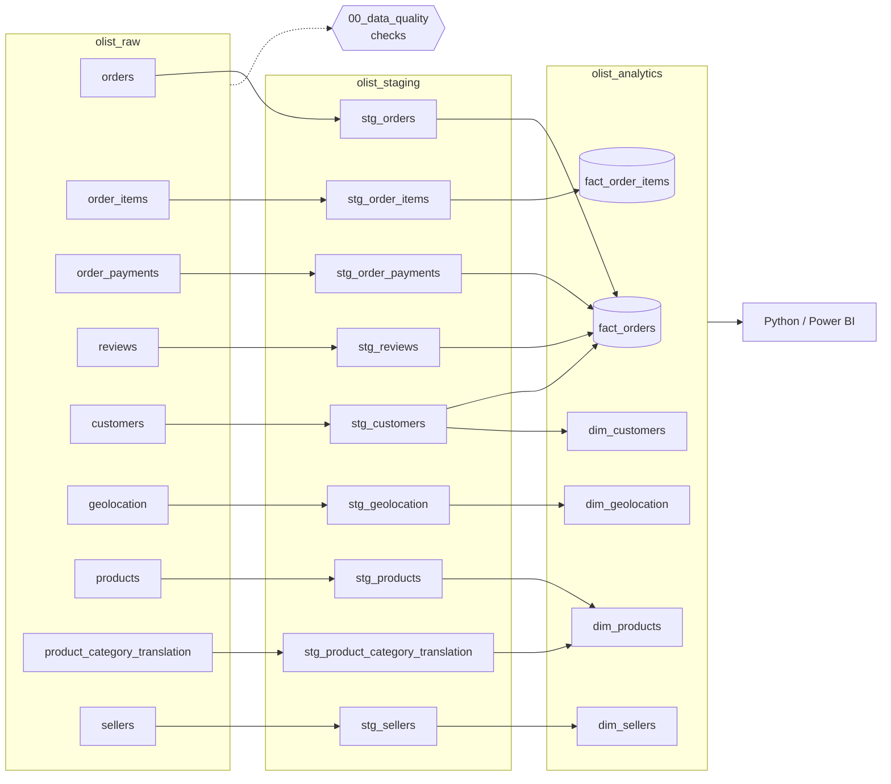
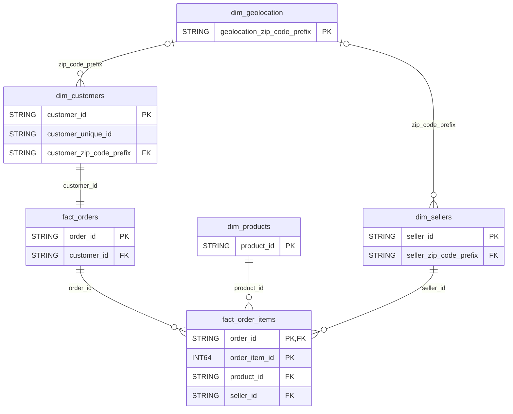

# Olist E-commerce Analytics

End-to-end analytics project on Olist's Brazilian marketplace data: **BigQuery (SQL) → Python → Power BI**.

## Key findings

Under construction...

Gráficos de Python

Captura del DashBoard

## Business questions

The analysis is framed around one question:

> **How can Olist grow the marketplace while keeping a strong customer experience?**

The [challenge brief](docs/olist_data_challenge.md) breaks it down into eight sub-questions. This project answers the five that best address growth and customer experience; the rest are listed under [Next steps](#next-steps).

| #   | Area                     | Question                                                                                         | Answered in                                                                                     |
| --- | ------------------------ | ------------------------------------------------------------------------------------------------ | ----------------------------------------------------------------------------------------------- |
| 1   | Marketplace performance  | How have orders, GMV and average order value evolved over time?                                  | Power BI · Executive Overview                                                                   |
| 2   | Revenue drivers          | Which categories and regions drive revenue and order volume?                                     | Power BI · Executive Overview                                                                   |
| 3   | Customer behaviour       | What share of customers purchase more than once?                                                 | Power BI · Executive Overview (KPI)                                                             |
| 4   | Delivery performance     | How often are orders late, where, and at which stage of fulfilment do delays originate?          | Power BI · Customer & Delivery                                                                  |
| 5   | Delivery vs satisfaction | Do review scores fall as delivery delay and total delivery time increase?                        | [`01_delivery_vs_satisfaction.ipynb`](notebooks/01_delivery_vs_satisfaction.ipynb) · Power BI · Customer & Delivery |

## Dataset

[Brazilian E-Commerce Public Dataset by Olist - Kaggle](https://www.kaggle.com/datasets/olistbr/brazilian-ecommerce)

- ~100k orders (2016–2018) across 9 relational tables

## Data pipeline

All transformations run in Google BigQuery (project `olist-inigoochoa`), organised in three datasets: `olist_raw` → `olist_staging` → `olist_analytics`.

<details>
<summary><b>Lineage diagram</b></summary>



</details>

## Data model (ERD)

Dimensional model in `olist_analytics`, keys and relationships only. `fact_order_items` holds the item grain and links to products and sellers; `fact_orders` holds the order grain and links to customers. Geolocation joins on the zip code prefix.



## Repository structure

```
olist-ecommerce-analytics/
├── docs/
│   └── olist_data_challenge.md     # Business brief and analysis questions
├── notebooks/
│   └── 01_delivery_vs_satisfaction.ipynb   # Q5: delivery delay & total delivery time vs review score
├── sql/
│   ├── 00_data_quality/            # Checks on raw tables (nulls, duplicates, keys, ranges)
│   ├── 01_staging/                 # olist_raw → olist_staging: clean and type
│   └── 02_analytics/               # olist_staging → olist_analytics: facts & dimensions
│       ├── fact_order_items.sql    # Grain: one row per order item
│       └── fact_orders.sql         # Grain: one row per order (payments + reviews aggregated)
├── .gitignore
├── README.md
└── requirements.txt
```

## Project status

- ✅ SQL modeling
- ✅ Python analysis
- 🚧 Power BI dashboard

## Next steps

Out of scope for this version, in order of expected value:

- **Customer satisfaction drivers:** a multivariate analysis of review scores (category, seller, order value, freight, basket size) to separate the effect of delivery from other factors.
- **Delivery vs satisfaction, extended:** seller processing time and freight cost vs review score.
- **Seller performance:** a value × quality segmentation of sellers for operational follow-up.
- **Category opportunities:** categories combining growth, revenue and satisfaction.
- **Customer behaviour, extended:** regional differences and changes in purchasing behaviour over time.
- **Optional questions from the brief:** payments and instalments, freight as % of order value, basket analysis, shipping distance.

## Contact

- **Iñigo Ochoa, CFA**
- [inigo@inigoochoa.com](mailto:inigo@inigoochoa.com)
- [LinkedIn](https://www.linkedin.com/in/inigo-ochoa-gil)
